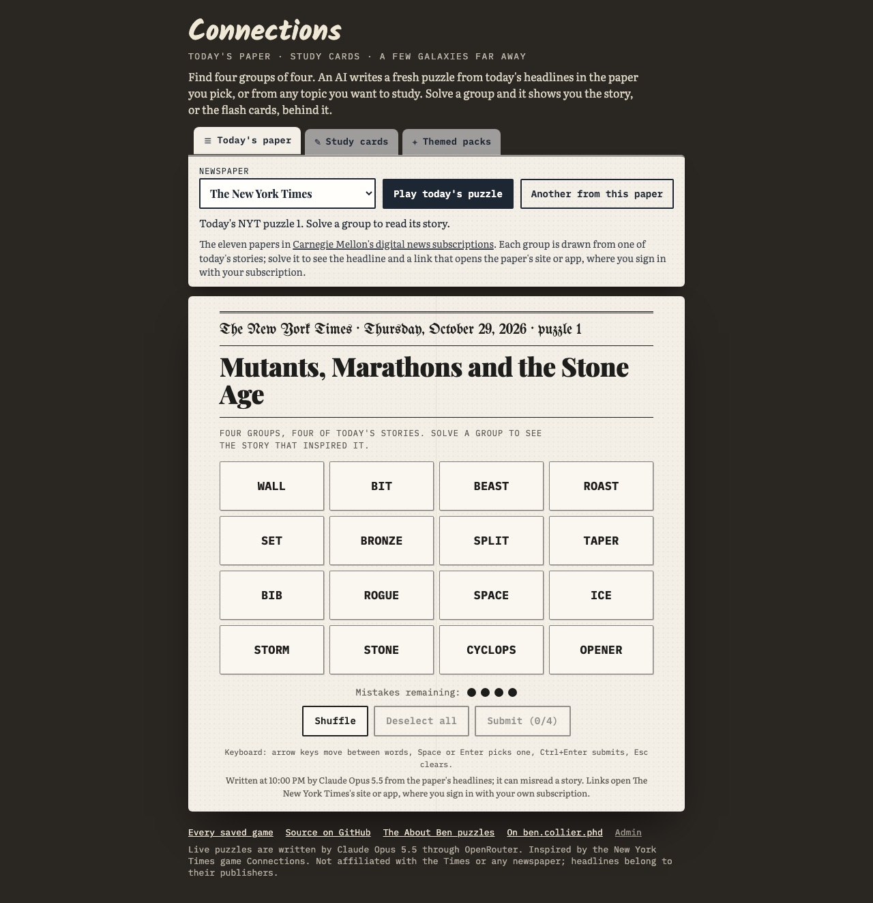
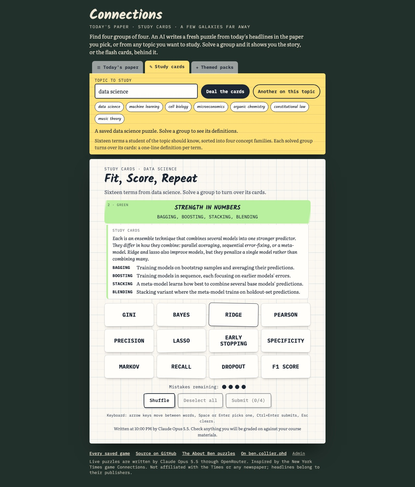
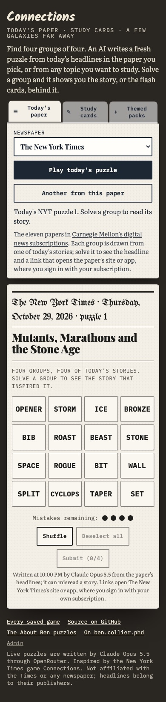
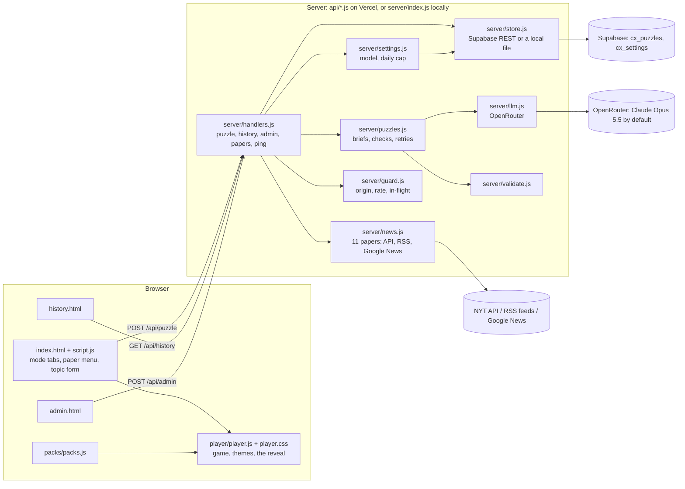
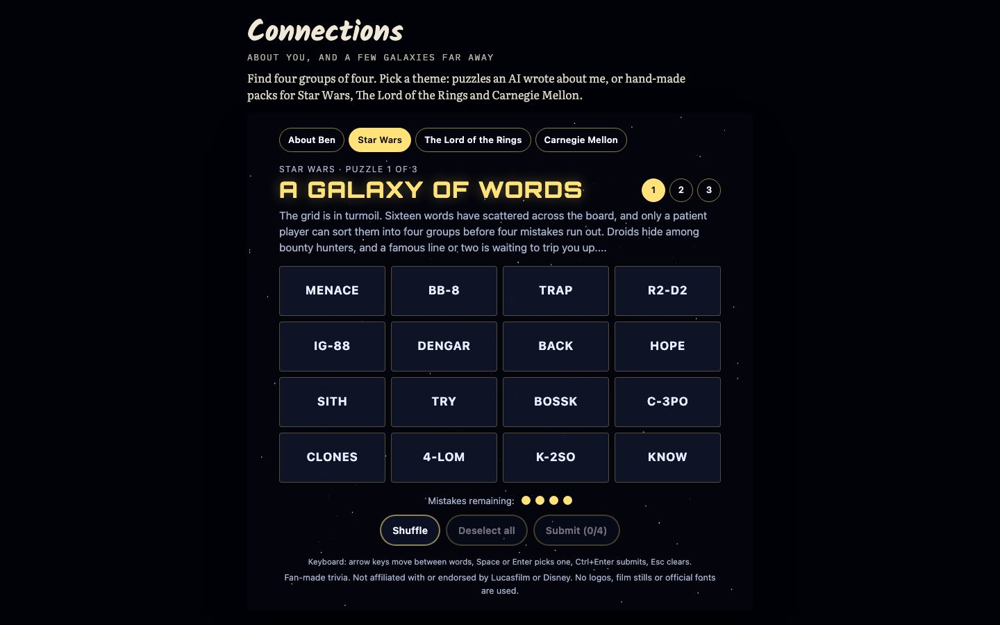
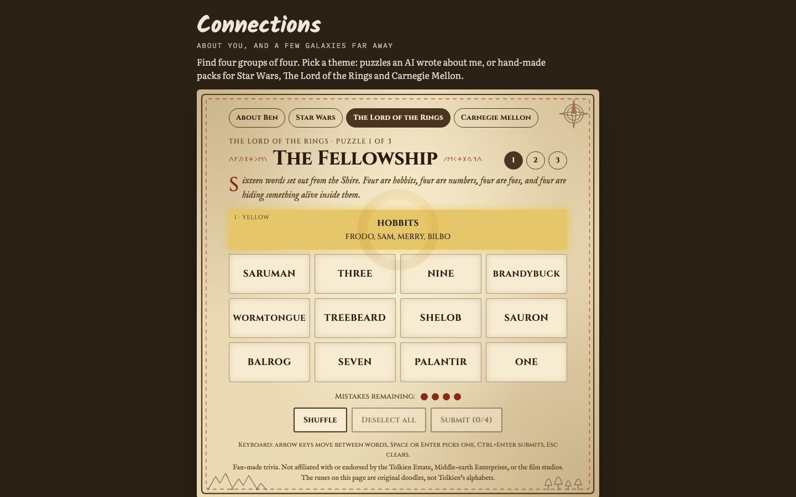
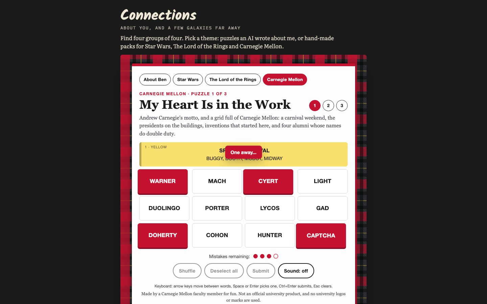
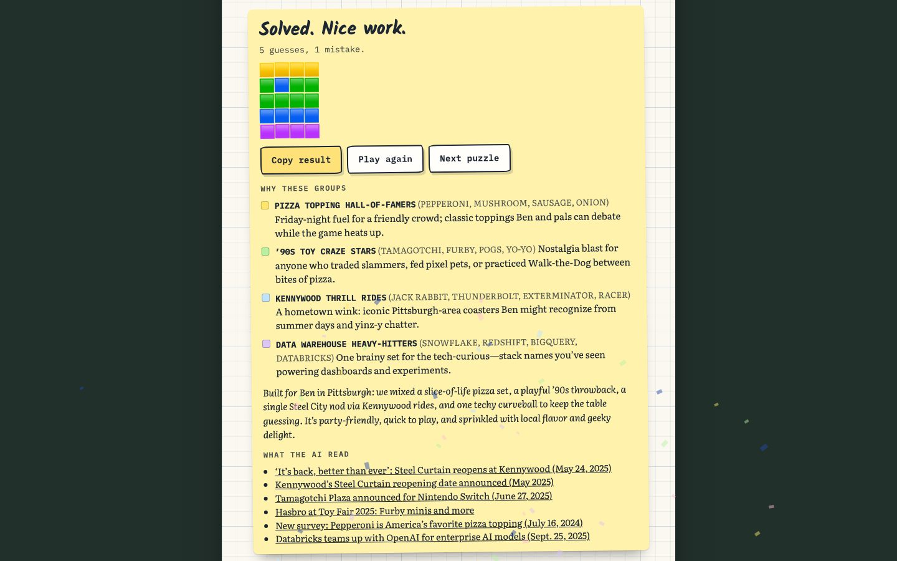

# Connections: today's paper, study cards, and a few galaxies

A word game in the style of the New York Times' Connections. An AI writes a fresh puzzle from today's headlines in the newspaper you pick (any of the eleven in Carnegie Mellon's digital news subscriptions), or from any topic you want to study. Solve a group and it shows you the story that inspired it, with a link to read it, or the flash-card definitions behind it. Hand-made packs for Star Wars, The Lord of the Rings and Carnegie Mellon still play in their own animated themes, and every puzzle the AI writes is kept, words, groups and stories, in a history you can replay.

**Play:**

- https://connections-about-you.vercel.app : the live game. Today's paper, study cards, the packs, the history and the admin page.
- https://bcollier.github.io/connections_demo/ : the packs only, with no server (a static page cannot hold a model key).
- https://ben.collier.phd/connections/ : the packs inside my site.

Deep links: `?mode=news&paper=wsj`, `?mode=study&topic=cell%20biology`, `?game=<id>` (a saved game from the history), and for the packs `?theme=starwars&puzzle=2` (themes are `ben`, `starwars`, `lotr`, `cmu`).

| Today's paper | A group solved: the story behind it | Study cards | On a phone |
| --- | --- | --- | --- |
|  |  |  |  |

## Contents

- [What it is and why](#what-it-is-and-why)
- [How to play](#how-to-play)
- [The three modes](#the-three-modes)
- [How a newspaper puzzle is made](#how-a-newspaper-puzzle-is-made)
- [How a study-card puzzle is made](#how-a-study-card-puzzle-is-made)
- [The history: every game is kept](#the-history-every-game-is-kept)
- [The admin page: which model writes](#the-admin-page-which-model-writes)
- [The themes](#the-themes)
- [Architecture](#architecture)
- [Data formats](#data-formats)
- [Themed packs, and how to add one](#themed-packs-and-how-to-add-one)
- [Animation and accessibility](#animation-and-accessibility)
- [Running it locally](#running-it-locally)
- [Deploying](#deploying)
- [Costs and brakes](#costs-and-brakes)
- [Privacy: what is and isn't published](#privacy-what-is-and-isnt-published)
- [Testing](#testing)
- [Limitations](#limitations)
- [Notes: using an LLM as a game engine](#notes-using-an-llm-as-a-game-engine)
- [Files](#files)
- [Credits](#credits)

## What it is and why

Connections gives you sixteen words and asks you to sort them into four groups of four. The groups get harder from yellow to purple, and the fun is in the red herrings: words that look like they belong to one group but are needed in another.

I built the first version for a class on coding with AI, to answer a question my students kept asking: can a language model be the part of a game that makes the content, and not just the part that chats? This version pushes on that in two directions. **Today's paper** makes the content *about something real and current*: each of the four groups is drawn from one of the day's stories, so solving the puzzle is a way of reading the paper, and the reveal sends you to the story. **Study cards** makes the content *useful*: sixteen terms from a subject, sorted into concept families, with a definition per term when you solve a group, so the game is a quiz you did not have to write. Both are written on demand by a model (Claude Opus 5.5 to begin with; an admin can change it), checked by code, and saved, so the same puzzle is free for everyone else that day.

## How to play

- Click (or tap) four words you think belong together, then **Submit**.
- A right guess slides the four words to the top as a colored band with the group's name. Yellow is the easiest group and purple the hardest.
- A wrong guess costs one of four mistakes (the dots). If three of your four words belong together, the game says **One away...**. Guessing the same four twice costs nothing.
- **Shuffle** moves the words around, which helps more than you'd think. **Deselect all** clears your picks.
- When you finish, the game explains every group and the trap in the puzzle, and **Copy result** puts your guesses on the clipboard as colored squares, like the NYT's share grid.

Keyboard: arrow keys move between words, Space or Enter picks one, Ctrl+Enter (Cmd+Enter on a Mac) submits, Esc clears the picks.

In the live modes, solving a group also opens a **reveal** under the band: for a newspaper puzzle, the headline, its abstract, how the four words connect to it, and a link to read the full story; for study cards, why the four terms belong together and a one-line definition of each. If you run out of mistakes, the unsolved groups are revealed the same way, so you still get the stories.

## The three modes

| Mode | What you pick | What the AI does | What a solved group reveals |
| --- | --- | --- | --- |
| **Today's paper** | A newspaper from the eleven in [CMU's digital news subscriptions](https://guides.library.cmu.edu/digital_news/home): The New York Times, The Wall Street Journal, The Washington Post, Financial Times, Bloomberg, The Atlantic, Business Insider, The Information, The New Yorker, Pittsburgh Business Times, Pittsburgh Post-Gazette. | Reads today's headlines and summaries, picks four stories as different as it can, and writes one group from each, with red herrings across groups. | The story: headline, abstract, how the words connect, and a link that opens the paper's site or app (where you sign in with your own subscription). |
| **Study cards** | A topic: "data science", "cell biology", "the French Revolution". | Chooses sixteen terms a student should know and sorts them into four concept families, one of them a trap for beginners. | Why the four belong together, and a definition of each term. |
| **Themed packs** | A theme inside the game. | Nothing: these are hand-made (the About Ben pack was written by GPT-5 about me and saved). | The group's explanation at the end, as before. |

**Another puzzle.** The first time anyone picks a paper on a given day, the AI writes that day's first puzzle for it and saves it. Everyone after that plays the saved one instantly. "Another from this paper" gives you a saved puzzle you have not played in this browser session, and only writes a new one when none is left, built on different stories (the prompt is told what the day's earlier puzzles used). Study topics work the same way, keyed by the topic.

## How a newspaper puzzle is made

`server/news.js` fetches the stories, `server/puzzles.js` briefs the model and checks the answer, and `server/handlers.js` decides whether to write or to serve a saved puzzle. The same code runs in the local Express server and the Vercel functions.

```mermaid
sequenceDiagram
  participant P as Player's browser
  participant S as Server (Express or Vercel function)
  participant D as Supabase (cx_puzzles, cx_settings)
  participant N as The paper (API, RSS, or Google News)
  participant M as Model via OpenRouter
  P->>S: POST /api/puzzle {mode: news, paper: nyt, seen: [ids]}
  S->>D: saved puzzles for nyt + today?
  alt one the player has not seen
    D-->>S: puzzle
    S-->>P: {cached: true, puzzle}
  else none left
    S->>S: brakes: origin, daily cap, per-visitor rate, in-flight
    S->>N: today's headlines (fresh, deduplicated, mixed by section)
    N-->>S: up to 45 numbered stories
    S->>D: which model is set?
    S->>M: brief + numbered stories + today's earlier groups to avoid
    M-->>S: JSON: 4 groups, each with a story_index
    S->>S: schema, 16 distinct words, no shared roots, 4 different stories
    alt a check fails
      S->>M: same brief + "your last answer was rejected: ..." (up to 2 retries)
    end
    S->>S: attach each story's title, link, abstract by its number
    S->>D: save {mode, key, model, cost, puzzle}
    S-->>P: {cached: false, puzzle}
  end
  P->>P: play; each solved group reveals its story
```

**Where the headlines come from.** Three sources, tried in order until there are at least ten fresh stories:

1. *A publisher API with a key.* The New York Times [Top Stories API](https://developer.nytimes.com/) (`NYT_API_KEY`), which returns a real abstract per story across the home page and several sections. Optional: without a key the Times' RSS feeds are used, and their descriptions are the same abstracts.
2. *The paper's own RSS feeds* (`feeds` in `PAPERS`): headline, one-line summary, link, date, section. Items older than the paper's `maxAgeHours` (36 hours for dailies, up to five days for weeklies like The New Yorker) are dropped, so a stale feed cannot pass as today's news.
3. *Google News search for the paper's site* (`site:wsj.com when:2d`), which gives current headlines whose links redirect to the paper. This is the only source for The Wall Street Journal (its public RSS feeds stopped updating in 2025) and Pittsburgh Business Times (its feeds sit behind a bot wall), and the fallback for The Washington Post when its feed servers are down.

The parser is sixty lines of regular expressions over RSS and Atom, with no dependency; feeds are simple enough. Section names come from the feed (`Technology.xml`) or the article path (`/2026/10/29/arts/`), never from `<category>` tags, which the Times uses for people's names.

**The brief.** A system line sets the editor's standards (one plain group, one wordplay group, red herrings required, labels are categories not headlines). The user message numbers the stories and gives seven rules: four stories as different as possible, words that are *in or evoked by* the story but solvable from general knowledge, category-style labels, at least three red herrings, sixteen distinct words with no shared roots, an explanation per group that gives away no more than the headline does, and nothing naming victims. Then ten real NYT groups as format examples, the color rubric, and the exact JSON to return, with a `story_index` per group.

**Taking the link back by number.** The model never writes a URL. It names a story by its number, and the server attaches that story's title, link, abstract, section and date. A group that points outside the list, or two groups on the same story, is a rejection and a retry. So every "Read the full story" link is one the server fetched from the paper that day.

**Checks and retries.** JSON out of the reply (`server/parse.js`), the zod schema (`server/validate.js`), colors normalized and each used once, then the rules that matter: sixteen different words, no two sharing a root (RUN and RUNNING), no word repeated inside a label, four different labels, an explanation per group. A failure goes back to the model as "your last answer was rejected: ..." with a higher temperature, up to two retries. Provider errors (a 429, an empty credit balance) are not retried; they come back to the page as a plain message.

## How a study-card puzzle is made

The same pipeline with a different brief and no story fetch. The prompt asks for sixteen real terms from the topic as single tokens, in four concept families (kinds of something, steps of a process, things measured in the same unit, terms named after people, words with a second everyday meaning), at least one of which is a trap a beginner would misfile; an explanation per group that teaches what separates the four from the near misses; and a definition per word in at most fifteen words, in the words' order. "Accuracy over cleverness" is a rule in the prompt, and the game's footer says to check anything you will be graded on. The check adds one rule: four definitions per group, or the answer is rejected.

A puzzle on *data science* came back as: metrics from a confusion matrix (PRECISION, RECALL, SPECIFICITY, F1 SCORE), ensembles (BAGGING, BOOSTING, STACKING, BLENDING), regularization (LASSO, RIDGE, DROPOUT, EARLY STOPPING), and people behind the terms (GINI, BAYES, PEARSON, MARKOV), with GINI as the trap: it looks like a metric.

## The history: every game is kept

Every puzzle the AI writes is saved as a row in `cx_puzzles` (Supabase): the mode, the key (`nyt:2026-10-29` or the topic), the model, what the call cost, and the whole puzzle as JSON, which includes all sixteen words, the four labels and colors, the explanation of each group, and for newspaper puzzles each group's story (headline, link, abstract, section, date) and for study cards the definitions. Nothing about the player is stored: no name, no IP address, no guesses.

[`history.html`](history.html) lists them newest first with a filter by kind and by paper or topic, shows every group with its words and story link, and has a **Play this game** button that opens `index.html?game=<id>`. `GET /api/history` serves the same list as JSON (`?mode=news&key=nyt:2026-10-29&limit=30&offset=0`, or `?id=` for one game).

Locally, without Supabase, the same history lives in `data/cx_store.local.json` (git-ignored), so a page reload does not pay for a new puzzle. On Vercel there is no disk, so without the tables nothing is kept and the history page says so.

## The admin page: which model writes

[`admin.html`](admin.html) asks for the `ADMIN_PASSWORD` set on the server (compared in constant time, with a delay on a wrong guess), then shows the model in use, how many new puzzles were written today against the daily cap, what they cost, and the recent puzzles. The model is a dropdown of OpenRouter's models from Anthropic, OpenAI, Google, xAI, Meta, Mistral, DeepSeek and Qwen, with their prices per million tokens and an estimate per puzzle. Saving writes `cx_settings` and takes effect on every server instance within a minute. The default is `anthropic/claude-opus-5.5` (`DEFAULT_MODEL`), and the daily cap defaults to 150 (`DAILY_CAP`).

## The themes

The two live modes have skins of their own: **Newsprint** for today's paper (an off-white sheet with a hairline column grid, a blackletter dateline, a bold serif masthead, groups as boxed headlines and each story as a clipping with a drop cap), and the notebook skin from About Ben for study cards (index-card tiles on graph paper, with the definitions as a stack of cards under the band). Neither uses a newspaper's logo or typeface; "The Daily Connections" look is this game's own.

Each theme is a skin over the same game: the rules, controls and layout don't change. Everything is drawn with CSS, inline SVG and canvas. There are no logos, film stills, official fonts or trademarked artwork; the themes evoke their worlds with original shapes and colors.

| Theme | Look | When you solve a group | When you win |
| --- | --- | --- | --- |
| **About Ben** | Graph paper, tilted index-card tiles, the handwriting and mono fonts from my site. | A highlighter swipes across the band. | Paper confetti in highlighter colors. |
| **Star Wars** | Deep space, a canvas starfield drifting toward you, gold type. Each puzzle opens with an original crawl that scrolls up a tilted plane (skip it with the button or Esc). | The stars stretch into hyperspace streaks; the band ignites from left to right like a blade. | A longer jump to lightspeed, a small screen rumble, star-shaped sparks. |
| **The Lord of the Rings** | Parchment with darkened edges, a map border that inks itself in with a dashed route inside it, a compass rose, mountains and trees, and rune-like flourishes beside the title. The runes are invented strokes, not Tolkien's alphabets. | A golden ring rises over the band and glows. | A larger ring and falling golden leaves. |
| **Carnegie Mellon** | A tartan drawn in CSS gradients (Carnegie red, iron gray, black and a gold thread), a white card with a red top rule. | Music notes float up from the band. | A bagpipe marches across the bottom, squeezing its bag, with tartan confetti. |

Sound is off by default everywhere. Only the Carnegie Mellon theme has any: a **Sound: off** button that, once you turn it on, plays a short synthesized drone and chanter tune (Web Audio, an original tune in A mixolydian). Browsers only allow sound after a click, and this needs that click.

### The puzzles

| Pack | Puzzles |
| --- | --- |
| About Ben (written by GPT-5, saved) | Pizza, Pogs and Kennywood · Arcade Night · The Experiment · The Data Stack · Model Behavior |
| Star Wars | A Galaxy of Words · The Saber Test · Outer Rim Run |
| The Lord of the Rings | The Fellowship · Second Breakfast · A Long Walk to Mordor |
| Carnegie Mellon | My Heart Is in the Work · Tartan Pride · Carnival Weekend |

The hand-made puzzles follow the NYT pattern: a plain yellow group, a purple group built on wordplay, and at least one red herring that crosses groups (six tiles look like droids, but two of them are also bounty hunters, and only four bounty hunters are on the board). The facts were checked against fan wikis (Wookieepedia, Tolkien Gateway) and Carnegie Mellon's own pages, and nothing spoils more than the films' and books' well-known plots.

## Architecture



The handlers are written once as `(req, res)` functions; `api/puzzle.js` and the others are one-line Vercel wrappers, and `server/index.js` mounts the same functions on Express and serves the folder, so `http://localhost:3000` is the whole app. The older "about you" generator (`server/generator.js`, `api/generate.js`) is still there and still works with its own keys; its form appears under the About Ben theme only when the server has one.

Three places run the player:

| Where | Modes | Server |
| --- | --- | --- |
| Vercel (`connections-about-you.vercel.app`) | Today's paper, study cards, packs, history, admin | `api/*.js` |
| GitHub Pages (`bcollier.github.io/connections_demo`) | Packs only, with a note pointing to the live game | None |
| ben.collier.phd/connections/ | Packs only | None |

The site keeps a copy of `player/player.js`, `player/player.css` and `packs/packs.js` that its `scripts/sync_connections.sh` pulls from this repo, so there is one source of truth (here) and the site is still plain static files in its own style.

## Data formats

### A puzzle

The same shape comes back from the live writers and sits in every pack. Fields marked *pack* are required only in hand-curated packs; fields marked *news* or *study* appear only in those puzzles.

```jsonc
{
  "id": "sw-1",                        // pack: unique across all packs
  "title": "Mutants, Marathons and the Stone Age", // pack; the live writers supply one too
  "intro": "...",                      // optional; the Star Wars crawl uses it
  "explanation": "ICE tempts solvers toward the X-Men...", // the puzzle's design, shown at the end
  "categories": [                      // exactly 4
    {
      "label": "___ AGE",              // 1 to 40 characters
      "words": ["STONE", "ICE", "BRONZE", "SPACE"], // exactly 4, each 1 to 20 characters
      "explanation": "Each completes a named era...", // up to 400 characters; pack: required
      "color": "Purple",               // Yellow | Green | Blue | Purple, each once
      "story": {                       // news: attached by the server from the day's list
        "title": "Three Stone Age Caves Reveal Continual Cannibalism",
        "url": "https://www.nytimes.com/2026/10/29/science/...",
        "summary": "...", "section": "Science", "published": "2026-10-29T...Z"
      },
      "definitions": ["...", "...", "...", "..."] // study: one per word, in order
    }
  ],
  "source": { "id": "nyt", "name": "The New York Times", "short": "NYT", "home": "https://www.nytimes.com/", "date": "2026-10-29", "feed": "The New York Times's RSS feeds" }, // news; study: { id: "study", name: topic }
  "generated": { "model": "anthropic/claude-opus-5.5", "ts": "...", "mode": "news" },
  "recommendations": [ { "title": "...", "url": "https://...", "type": "article" } ] // the older about-you puzzles only
}
```

Rules the validator enforces (`server/validate.js`, `puzzleProblems`): four groups of exactly four words; sixteen different words after stripping everything but letters and digits; four different labels; in strict mode (packs) all four colors once each, an explanation for every group, and words in display form. The live writers add: no two words sharing a root, no word inside a label, four different stories (news), four definitions per group (study).

### A saved game (`cx_puzzles`)

```jsonc
{ "id": "uuid", "mode": "news", "key": "nyt:2026-10-29", "model": "anthropic/claude-opus-5.5", "cost_usd": 0.0697, "puzzle": { /* as above */ }, "created_at": "..." }
```

### A pack

```jsonc
{
  "id": "starwars",            // also the ?theme= value
  "name": "Star Wars",         // shown in the picker
  "theme": "starwars",         // which skin: ben | starwars | lotr | cmu
  "blurb": "Droids, bounty hunters...",
  "disclaimer": "Fan-made trivia. Not affiliated with...", // shown under the game
  "puzzles": [ /* three or more puzzles */ ]
}
```

## Themed packs, and how to add one

The packs are plain JSON in `packs/`. `scripts/build-packs.mjs` validates all of them and writes `packs/packs.js`, which the pages load with a `<script>` tag rather than `fetch`, so the game also works when you open `index.html` straight from disk.

To add a puzzle to an existing pack: add it to the pack's `puzzles` array, run `npm run packs`, and play it.

To add a pack with an existing skin, set its `theme` to one of the skins. To add a new skin:

1. Write `packs/<id>.json` with `"theme": "<id>"`, and add the id to `PACK_ORDER` and `THEMES` in `scripts/build-packs.mjs`.
2. In `player/player.css`, add a `.cx[data-theme="<id>"]` block. Most of a skin is custom properties: background, tile, selection and button colors, the four group colors (`--cx-y`, `--cx-g`, `--cx-b`, `--cx-p`), fonts, corner radius, and `--cx-cw`, the average capital width of the tile font, which the tiles use to shrink long words onto one line. The newsprint skin is a good small example: it is custom properties, a background, and a few rules for the masthead, the bands and the reveal.
3. In `player/player.js`, add an entry to `THEMES` (end-of-game lines and the confetti's colors and shape). For decoration, `applyTheme()` adds SVG to the decoration layer, and `themeSolve()` and `finish()` hold the per-group and win effects.
4. Run `npm test` and `npm run test:e2e`, then look at the new screenshots.

Writing a good puzzle by hand, in my experience: start from the purple group (the wordplay), then pick one word in it that also fits a plainer group, and make sure the plainer group has exactly four other candidates so elimination still gives one answer. Then read every word against every label. Most of my bugs were a fifth word that also fit.

## Animation and accessibility

**Animation.** Everything is CSS keyframes, the Web Animations API or a canvas, with no libraries.

- *Tile bounce* on every pick, and a hop, tile by tile, when you submit.
- *Shuffle and solve* use FLIP: measure every tile, move them in the page, then animate each from where it was. A solved group's tiles take their group color and slide into the top row, then merge into the band.
- *Wrong guess*: a shake and a red ring on the four tiles, and the mistake dot pops.
- *Toast* for "One away...", "Already guessed!" and copy confirmations.
- *Confetti* is one full-window canvas shared by every game on the page; each theme has its own colors and shape (paper strips, star sparks, leaves that drift, tartan squares).
- The starfield only runs while the Star Wars theme is showing, and stops otherwise.

**Accessibility.**

- Tiles are real buttons with `aria-pressed`, in a group with roving `tabindex`, so Tab enters the grid once and arrow keys move inside it.
- Results go to a live region ("Correct. DROIDS: ...", "One away... 3 mistakes remaining."), the toast is a polite status region, and the end-of-game heading takes focus.
- Color is never the only signal: each band says its level in words (`1 · yellow`) and its name, the mistakes counter has a text label and a screen-reader sentence, and the share grid has an `aria-label` summary.
- `prefers-reduced-motion` turns off every movement: no crawl (the intro is plain text), no starfield motion, no hops, shakes, slides or confetti. The game plays the same.
- Focus rings are visible in every theme, buttons are at least 44px tall, and the layout works at 360px with no sideways scrolling (the tests check this).

## Running it locally

```bash
npm install
cp .env.example .env     # set OPENROUTER_API_KEY and ADMIN_PASSWORD; Supabase and NYT_API_KEY are optional
npm start                # http://localhost:3000 serves the page and the API
```

Open http://localhost:3000. Today's paper loads The New York Times puzzle (the first one of the day takes about half a minute to write; after that it is instant from the local store in `data/cx_store.local.json`). The history and admin pages are at `/history.html` and `/admin.html`.

Without any key, the page still serves and the packs play; the live modes say the writer is switched off. `window.CONNECTIONS_API_BASE` in [`config.js`](config.js) points a hosted copy at a server somewhere else.

Endpoints: `POST /api/puzzle`, `GET /api/papers`, `GET /api/history`, `POST /api/admin`, `GET /api/ping`, and from the first version `POST /api/generate`, `GET /api/about-history` (local only, read by [`viewer.html`](viewer.html)) and `POST /api/client-log`.

## Deploying

- **Vercel** (`connections-about-you`, team `cmu-demos`): `npx vercel deploy --prod` from this folder. `vercel.json` gives the puzzle function up to 300 seconds. Set these in the project's environment variables (never in the repo):

  | Variable | Needed for |
  | --- | --- |
  | `OPENROUTER_API_KEY` | Writing puzzles at all. |
  | `ADMIN_PASSWORD` | The admin page. Make a new one for this project. |
  | `SUPABASE_URL`, `SUPABASE_SERVICE_ROLE_KEY` | Keeping the history and the admin's model choice. Run [`supabase/001_cx.sql`](supabase/001_cx.sql) once in the project's SQL editor to create `cx_settings` and `cx_puzzles`. Without these, every visit may write a new puzzle and nothing is kept. |
  | `NYT_API_KEY` | Optional: real abstracts from the Times' Top Stories API. |
  | `DEFAULT_MODEL`, `DAILY_CAP`, `NEWS_TZ`, `PER_IP_WINDOW`, `PER_IP_DAY`, `MAX_IN_FLIGHT`, `ALLOWED_ORIGINS` | Optional tuning; see [`.env.example`](.env.example). |

- **GitHub Pages** serves `main` from the repo root (`.nojekyll` keeps it from running Jekyll). Merging to `main` deploys it; it plays the packs and points to the live game for the rest.
- **ben.collier.phd**: in the site repo, run `scripts/sync_connections.sh` to copy the player and packs from this repo, rebuild with `python3 scripts/build.py`, and open a pull request there.

## Costs and brakes

A puzzle is one model call of about 5,000 input and 2,500 output tokens (the headlines are most of the input): about $0.07 on Claude Opus 5.5, $0.03 on Sonnet 5.5, under a cent on Haiku 5.5. OpenRouter reports the exact cost per call and it is saved with the puzzle, so the admin page can show what today cost. Saved puzzles cost nothing, and the first visitor of the day pays for everyone who picks the same paper.

The brakes, outermost first:

0. **Nothing is spent without a click.** Opening the page, or changing the paper, only asks the server for a saved puzzle (`savedOnly`); if there is none, the page says so and waits for the Play button. Crawlers, link previews and Vercel's own deployment screenshots load the page without clicking, and before this rule each of them paid for a puzzle.
1. **The OpenRouter key's own credit limit**, which is the guarantee.
2. **A daily cap** on new puzzles across all visitors and both modes (150 by default; the admin can change it), counted in the database, so it survives restarts. Past the cap, saved puzzles still play.
3. **Only this page may call the writer**: requests from other sites, or with no `Origin`, get a 403.
4. **One writer per puzzle.** Before writing, the server takes a short lease on the (paper, day) or topic, a row in `cx_settings` whose primary key makes the insert atomic. A second visitor who asks for the same puzzle in those seconds waits for the first one's save and plays it, instead of paying for a twin.
5. **Per-visitor limits**: six new puzzles per 15 minutes and twenty a day per IP address, and at most three in progress per server instance. These live in memory and reset with each new Vercel instance, so they slow abuse rather than stop it.

Every refusal comes back to the page as a plain message, and the page keeps whatever puzzle it was showing.

## Privacy: what is and isn't published

- **Published:** the hand-made packs; the five puzzles GPT-5 wrote about me (`packs/ben.json`, `data/history.jsonl`); and every puzzle the live writers produce, which anyone can read on the history page. Those contain headlines, links and abstracts from the papers (which belong to their publishers) and the model's words, and nothing about the player.
- **Never stored:** who played, from where, what they guessed, or what topic they typed beyond the topic itself as the puzzle's key. The admin password is compared on the server and kept only in the admin's own browser session.
- **Keys** live in `.env` (git-ignored) or the Vercel project, never in the repo.
- **Locally:** the local server writes its logs to `logs/` and the local history to `data/cx_store.local.json`, both git-ignored. The older about-you generator still appends to `data/history.jsonl`, which *is* tracked, so if you make puzzles about other people locally, restore it with `git checkout data/history.jsonl` before committing; the tests catch it if you forget.
- The page loads Google Fonts and nothing else from a third party. There is no analytics in this repo.

## Testing

```bash
npm test          # node:test: validator, packs, feed parsing, prompts, schema, handler input checks
npm run test:e2e  # Playwright: every pack theme at 1440 and 390 wide, plus keyboard + reduced motion at 360
npm run gifs      # re-records the README GIFs (needs ffmpeg)
```

`npm test` runs without a network or a model key. Beyond the pack checks of the first version, [`test/live.test.mjs`](test/live.test.mjs) covers the RSS and Atom parser (titles, links, cleaned summaries, dates, sections from the article path and never from keyword tags), that each of the eleven papers has a source, what the two briefs must contain, the extended schema (a story per group, four definitions per group), the one-line summary that keeps the day's puzzles from repeating, JSON extraction from a chatty reply, and the handlers' refusals: a foreign origin, a bad mode, an unknown paper, an empty topic, a wrong admin password, and no admin password configured.

The screenshots at the top of this file were taken with the same Playwright setup against the local server, playing a real puzzle of the day.

| Start | One group solved | Wrong guess | Win |
| --- | --- | --- | --- |
|  |  |  |  |

## Limitations

- **The AI's puzzles are uneven.** The checks guarantee the shape, not the quality. Some groups are lists without a trap, and the difficulty colors are the model's guess. Opus 5.5 is noticeably better at red herrings than the models of a year ago, which is why it is the default.
- **Headlines are thin for some papers.** The Wall Street Journal, The Washington Post (when its feeds are down) and Pittsburgh Business Times come through Google News as headlines only, so the model has less to work with, and their links go through a Google redirect before reaching the paper. A publisher API key fixes this where one exists (the Times today).
- **Facts can be wrong.** A group is the model's reading of a headline and a one-line summary. The reveal shows the story so a player can check.
- **Study cards are not a textbook.** Definitions are the model's, in fifteen words. The page says so.
- **Uniqueness isn't proven.** The validator checks that words don't repeat, not that only one grouping works. A fifth word that fits a group is the most common flaw, in AI puzzles and in mine.
- **Per-visitor limits are best effort.** They live in one Vercel instance's memory; the daily cap and the key's credit limit are the real brakes.
- **Fan content.** The Star Wars and Lord of the Rings packs reflect the films and books as I and the fan wikis understand them; corrections are welcome.

## Notes: using an LLM as a game engine

- The model is good at *candidates* and bad at *constraints*. It produces lively groups quickly, but it can't be trusted to keep "sixteen different words", so code checks it every time. Split the job: the model proposes, the program disposes.
- Every rule I could check in code, I moved out of the prompt's hopes and into the validator. The rules I couldn't check (fun, fair, not a resume) stayed in the prompt as plain constraints with numbers ("at most one group about work"), which the model follows far better than adjectives.
- Examples beat descriptions. Twelve real NYT groups in the prompt did more for the format and the difficulty ladder than any paragraph about what "purple" means.
- Without memory, a model is a creature of habit. The last-20 list was the cheapest fix for repetition I found.
- Red herrings are the hardest part, for the model and for me. The AI rarely builds a word that deliberately fits two groups; writing the themed packs by hand showed how much of the craft lives there.
- Fail soft. A game can't show a stack trace, so every error path ends in something playable, and the player is told plainly what happened.
- A static site can't keep a key secret, which is why the demo is saved puzzles. Deciding where the key lives (a server with hard spending limits) shaped the whole architecture more than the model choice did.
- Free open models (gpt-oss-120b on Jetstream2) were good enough once search moved out of the model and into the server. The model's own web search was convenient but made cost and latency less predictable.
- Showing the AI's reasons and sources at the end turned mistakes into conversation: players argue with a wrong fact, which is more fun than being silently misled.
- The second version taught me the opposite lesson about search: for news, don't let the model find the stories. Fetching the day's headlines in code and handing the model a numbered list, then taking the link back by number, means every "read the full story" link is real. The model never types a URL.
- Caching by (paper, day) and (topic) changed the economics more than the model choice. The first visitor pays about seven cents; everyone else that day plays the same puzzle free, and "Another puzzle" only writes a new one when the saved ones run out.
- For study cards, asking for a definition per word was the cheapest way to make the model honest: a term it cannot define in fifteen words tends to be one it should not have used.


## Files

| Path | What it is |
| --- | --- |
| `index.html`, `script.js`, `styles.css` | The page: mode tabs, the paper menu, the topic form, deep links, the page around the game. |
| `history.html` | Every saved game, with a filter and a replay button. |
| `admin.html` | Password, model dropdown with prices, daily cap, today's count and cost, recent puzzles. |
| `player/player.js`, `player/player.css` | The game, its themes (notebook, Star Wars, Lord of the Rings, Carnegie Mellon, newsprint) and the reveal under a solved group. Shared with ben.collier.phd. |
| `packs/*.json`, `packs/packs.js` | The puzzle packs and their generated bundle. |
| `scripts/build-packs.mjs` | Validates the packs and writes `packs/packs.js`. |
| `config.js` | Where the server runs. Empty means same origin, or localhost:3000 from a file. |
| `viewer.html` | The About Ben puzzles side by side, or the local about-you history. |
| `server/handlers.js` | The HTTP handlers: puzzle, history, admin, papers, ping. Shared by Express and Vercel. |
| `server/news.js` | The eleven papers and how to read each one's headlines. |
| `server/puzzles.js` | The two briefs, the checks, the retries. |
| `server/llm.js` | OpenRouter: one completion, the model list with prices. |
| `server/store.js` | Supabase through its REST API, or a local JSON file in development. |
| `server/settings.js` | The model and the daily cap: database value, env default, one-minute cache. |
| `server/guard.js` | Origin check, per-visitor rate limits, in-flight cap. |
| `server/validate.js`, `server/parse.js` | The puzzle schema and checks; JSON extraction from a model reply. |
| `server/generator.js` | The first version's about-you writer (OpenAI or Jetstream2 + Tavily). |
| `server/index.js` | Local Express server: the handlers above, static files, the about-you routes. |
| `api/*.js`, `vercel.json` | The Vercel functions (one line each) and their limits. |
| `supabase/001_cx.sql` | The two tables: `cx_settings`, `cx_puzzles`. |
| `data/history.jsonl` | The first version's saved puzzles (only about me). |
| `nyt_connections_groups_*.csv` | Real NYT groups used as examples in the prompts. |
| `test/` | `packs.test.mjs`, `live.test.mjs` (node:test) and `e2e/` (Playwright checks and the GIF recorder). |
| `docs/screenshots/`, `docs/gifs/` | Screenshots and README GIFs. |

## Credits

- Inspired by [Connections](https://www.nytimes.com/games/connections) from The New York Times Games, by Wyna Liu. This project is not affiliated with or endorsed by The New York Times.
- The Star Wars and The Lord of the Rings packs are fan-made trivia, with no affiliation with or endorsement by Lucasfilm, Disney, the Tolkien Estate, Middle-earth Enterprises or the film studios. All names belong to their owners; all artwork here is original CSS and SVG.
- The Carnegie Mellon pack is my own, made for fun as a faculty member, and is not an official university product. No university logos or marks are used.
- Fonts from Google Fonts: Kalam, IBM Plex Mono, Literata, Cinzel, IM Fell English, Orbitron, Playfair Display and UnifrakturMaguntia.
- Headlines come from each paper's own RSS feeds, the New York Times Top Stories API, or Google News, and belong to their publishers. The newspaper list is Carnegie Mellon University Libraries' [digital news subscriptions](https://guides.library.cmu.edu/digital_news/home); access to the stories is through each reader's own subscription.
- Built with Claude Code. Live puzzles are written by Claude Opus 5.5 through [OpenRouter](https://openrouter.ai/) (the model is a setting). The About Ben pack was written by OpenAI GPT-5, and the earlier free route used gpt-oss-120b on [Jetstream2](https://jetstream-cloud.org/) (NSF ACCESS) with search by [Tavily](https://tavily.com/).
